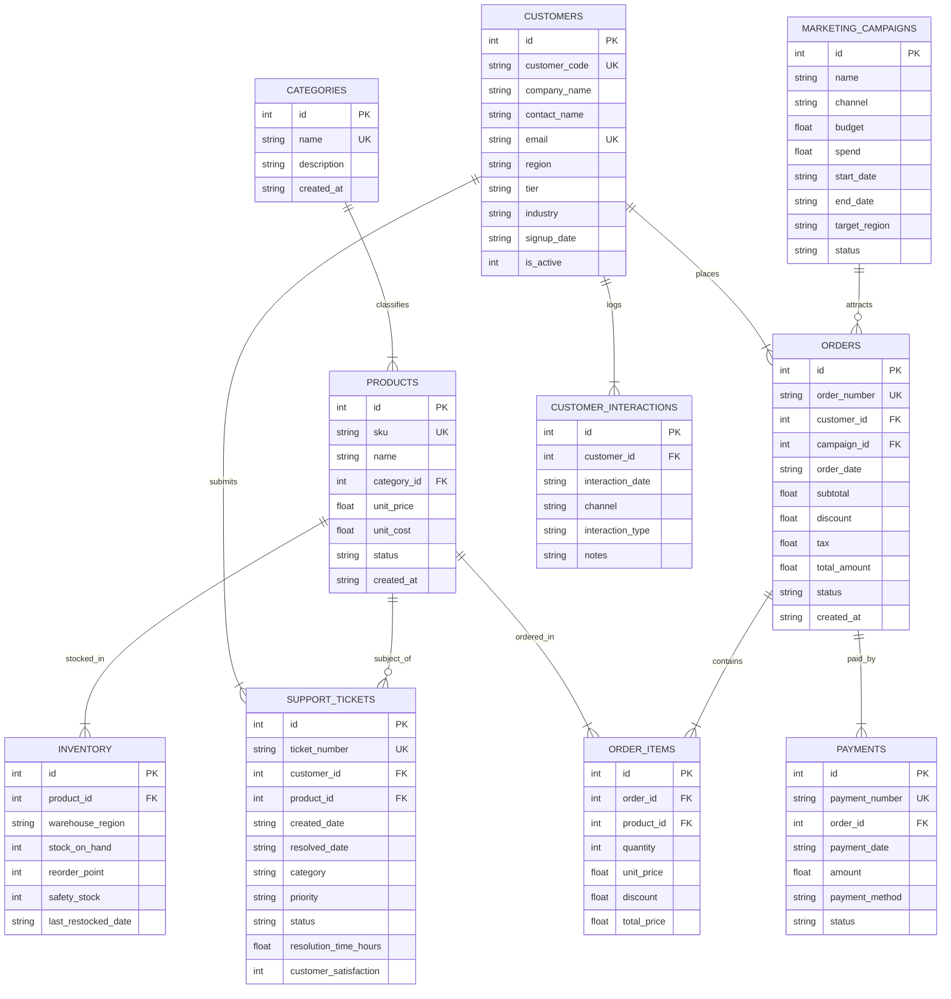

# IntelliOps AI — Relational Business Database Specification
**Document Version:** 1.0.0 (Phase 4 Deliverable)  
**Target Platform:** IntelliOps AI  
**Database Technology:** SQLite 3 (Production-grade normalized relational schema)  
**File Location:** `backend/datascout.db`  
**Status:** Implemented, Seeded, and Validated  

---

## 1. Executive Summary

To support **IntelliOps AI's** machine learning forecasting, customer churn prediction, product demand estimation, and causal decision intelligence, the database has been evolved from a flat transactions scaffold into a fully normalized, relational enterprise business schema.

Key Principles Upheld:
1. **Preservation of Existing Data:** The legacy `transactions` (1,000 rows) and `payroll` (3 rows) tables, as well as enterprise metadata tables (`documents`, `agent_logs`, `query_audit`, `custom_agents`, `user_settings`) were **preserved with 100% backward compatibility**.
2. **Foreign Key Integrity:** Strict SQLite foreign key enforcement (`PRAGMA foreign_keys = ON;`) with cascading rules.
3. **Deterministic Synthetic Data:** Generated with reproducible seed (`seed=42`) spanning 2 full calendar years (2024–2025).
4. **Zero Data Leakage:** Customer churn target defined strictly on a 90-day inactivity cutoff rule without introducing target-leaking synthetic features.

---

## 2. Entity-Relationship (ER) Diagram



---

## 3. Relational Tables & Field Definitions

### 3.1 `categories`
| Column | Type | Constraints | Description |
| :--- | :--- | :--- | :--- |
| `id` | INTEGER | PRIMARY KEY AUTOINCREMENT | Category identifier |
| `name` | TEXT | NOT NULL, UNIQUE | Category name (e.g., Enterprise Software) |
| `description` | TEXT | NULLABLE | Detailed description |
| `created_at` | TEXT | NOT NULL DEFAULT CURRENT_TIMESTAMP | Record creation timestamp |

### 3.2 `products`
| Column | Type | Constraints | Description |
| :--- | :--- | :--- | :--- |
| `id` | INTEGER | PRIMARY KEY AUTOINCREMENT | Product identifier |
| `sku` | TEXT | NOT NULL, UNIQUE | Product SKU (e.g., `SW-DS-CORE`) |
| `name` | TEXT | NOT NULL | Human-readable product name |
| `category_id`| INTEGER | NOT NULL REFERENCES categories(id) | Foreign key to category |
| `unit_price` | REAL | NOT NULL, CHECK(unit_price > 0) | Selling price per unit |
| `unit_cost`  | REAL | NOT NULL, CHECK(unit_cost > 0) | Direct cost to deliver per unit |
| `status`     | TEXT | NOT NULL, CHECK(status IN ('active', 'discontinued', 'upcoming')) | Operational status |

### 3.3 `customers`
| Column | Type | Constraints | Description |
| :--- | :--- | :--- | :--- |
| `id` | INTEGER | PRIMARY KEY AUTOINCREMENT | Unique customer ID |
| `customer_code` | TEXT | NOT NULL, UNIQUE | Business code (e.g., `CUST-0042`) |
| `company_name` | TEXT | NOT NULL | Enterprise customer name |
| `contact_name` | TEXT | NOT NULL | Primary contact person |
| `email` | TEXT | NOT NULL, UNIQUE | Primary contact email |
| `region` | TEXT | NOT NULL, CHECK(region IN ('NA', 'EMEA', 'APAC', 'LATAM')) | Customer geographic operating region |
| `tier` | TEXT | NOT NULL, CHECK(tier IN ('Enterprise', 'Mid-Market', 'SMB')) | Customer value tier |
| `industry` | TEXT | NOT NULL | Industry vertical (Finance, Healthcare, etc.) |
| `signup_date` | TEXT | NOT NULL | Account creation date (YYYY-MM-DD) |
| `is_active` | INTEGER | NOT NULL DEFAULT 1 CHECK(is_active IN (0, 1)) | Active account status flag |

### 3.4 `marketing_campaigns`
| Column | Type | Constraints | Description |
| :--- | :--- | :--- | :--- |
| `id` | INTEGER | PRIMARY KEY AUTOINCREMENT | Campaign identifier |
| `name` | TEXT | NOT NULL | Campaign name (e.g., `Q4-BudgetFlush-Promo`) |
| `channel` | TEXT | NOT NULL, CHECK(channel IN ('Email', 'Search / PPC', 'Social Media', 'Webinar / Event', 'Direct Outreach', 'Partner Referral')) | Marketing acquisition channel |
| `budget` | REAL | NOT NULL, CHECK(budget >= 0) | Allocated spend limit |
| `spend` | REAL | NOT NULL, CHECK(spend >= 0) | Actual campaign expenditure |
| `start_date` | TEXT | NOT NULL | Start date |
| `end_date` | TEXT | NOT NULL | End date |
| `target_region` | TEXT | NOT NULL, CHECK(target_region IN ('All', 'NA', 'EMEA', 'APAC', 'LATAM')) | Geographic target |
| `status` | TEXT | NOT NULL DEFAULT 'completed' | Campaign lifecycle status |

### 3.5 `orders`
| Column | Type | Constraints | Description |
| :--- | :--- | :--- | :--- |
| `id` | INTEGER | PRIMARY KEY AUTOINCREMENT | Order ID |
| `order_number` | TEXT | NOT NULL, UNIQUE | Order tracking number (`ORD-202410-00123`) |
| `customer_id` | INTEGER | NOT NULL REFERENCES customers(id) | Ordering customer ID |
| `campaign_id` | INTEGER | NULLABLE REFERENCES marketing_campaigns(id) | Attributed marketing campaign |
| `order_date` | TEXT | NOT NULL | Date order was placed (YYYY-MM-DD) |
| `subtotal` | REAL | NOT NULL, CHECK(subtotal >= 0) | Sum of item total prices |
| `discount` | REAL | NOT NULL DEFAULT 0.0, CHECK(discount >= 0) | Order-level promotional discount |
| `tax` | REAL | NOT NULL DEFAULT 0.0, CHECK(tax >= 0) | Tax calculated on subtotal |
| `total_amount` | REAL | NOT NULL, CHECK(total_amount >= 0) | Final billable amount |
| `status` | TEXT | NOT NULL, CHECK(status IN ('completed', 'pending', 'cancelled', 'refunded')) | Fulfillment status |

### 3.6 `order_items`
| Column | Type | Constraints | Description |
| :--- | :--- | :--- | :--- |
| `id` | INTEGER | PRIMARY KEY AUTOINCREMENT | Line item ID |
| `order_id` | INTEGER | NOT NULL REFERENCES orders(id) ON DELETE CASCADE | Associated order |
| `product_id` | INTEGER | NOT NULL REFERENCES products(id) | Ordered product |
| `quantity` | INTEGER | NOT NULL, CHECK(quantity > 0) | Units ordered |
| `unit_price` | REAL | NOT NULL, CHECK(unit_price >= 0) | Product price at time of order |
| `discount` | REAL | NOT NULL DEFAULT 0.0, CHECK(discount >= 0) | Item line discount |
| `total_price` | REAL | NOT NULL, CHECK(total_price >= 0) | Net price (`qty * unit_price - discount`) |

### 3.7 `payments`
| Column | Type | Constraints | Description |
| :--- | :--- | :--- | :--- |
| `id` | INTEGER | PRIMARY KEY AUTOINCREMENT | Payment ID |
| `payment_number` | TEXT | NOT NULL, UNIQUE | Transaction reference (`PAY-202410-00123`) |
| `order_id` | INTEGER | NOT NULL REFERENCES orders(id) | Settled order |
| `payment_date` | TEXT | NOT NULL | Transaction date |
| `amount` | REAL | NOT NULL, CHECK(amount > 0) | Transaction currency amount |
| `payment_method` | TEXT | NOT NULL CHECK(payment_method IN ('Credit Card', 'Bank Wire', 'ACH Transfer', 'Net 30 Invoicing', 'PayPal')) | Settlement rail |
| `status` | TEXT | NOT NULL CHECK(status IN ('completed', 'pending', 'failed', 'refunded')) | Settlement status |

### 3.8 `inventory`
| Column | Type | Constraints | Description |
| :--- | :--- | :--- | :--- |
| `id` | INTEGER | PRIMARY KEY AUTOINCREMENT | Stock record ID |
| `product_id` | INTEGER | NOT NULL REFERENCES products(id) | Stocked product |
| `warehouse_region` | TEXT | NOT NULL CHECK(warehouse_region IN ('NA', 'EMEA', 'APAC', 'LATAM')) | Warehouse location |
| `stock_on_hand` | INTEGER | NOT NULL, CHECK(stock_on_hand >= 0) | Units available |
| `reorder_point` | INTEGER | NOT NULL, CHECK(reorder_point >= 0) | Threshold to trigger restocking |
| `safety_stock` | INTEGER | NOT NULL, CHECK(safety_stock >= 0) | Minimum contingency stock |
| `last_restocked_date`| TEXT | NULLABLE | Date of last replenishment |

### 3.9 `customer_interactions`
| Column | Type | Constraints | Description |
| :--- | :--- | :--- | :--- |
| `id` | INTEGER | PRIMARY KEY AUTOINCREMENT | Interaction touchpoint ID |
| `customer_id` | INTEGER | NOT NULL REFERENCES customers(id) | Customer involved |
| `interaction_date` | TEXT | NOT NULL | Timestamp of event |
| `channel` | TEXT | NOT NULL CHECK(channel IN ('Platform Login', 'API Call', 'Email Opened', 'Sales Call', 'Executive Review', 'Webinar')) | Engagement medium |
| `interaction_type` | TEXT | NOT NULL | Type of engagement |
| `notes` | TEXT | NULLABLE | Touchpoint context |

### 3.10 `support_tickets`
| Column | Type | Constraints | Description |
| :--- | :--- | :--- | :--- |
| `id` | INTEGER | PRIMARY KEY AUTOINCREMENT | Ticket ID |
| `ticket_number` | TEXT | NOT NULL, UNIQUE | Reference code (`TCK-00123`) |
| `customer_id` | INTEGER | NOT NULL REFERENCES customers(id) | Submitting customer |
| `product_id` | INTEGER | NULLABLE REFERENCES products(id) | Affected product |
| `created_date` | TEXT | NOT NULL | Incident report date |
| `resolved_date`| TEXT | NULLABLE | Incident close date |
| `category` | TEXT | NOT NULL CHECK(category IN ('Bug / Defect', 'Billing / Invoice', 'Integration Help', 'Performance', 'Feature Request', 'Onboarding')) | Issue type |
| `priority` | TEXT | NOT NULL CHECK(priority IN ('Low', 'Medium', 'High', 'Critical')) | Severity tier |
| `status` | TEXT | NOT NULL CHECK(status IN ('open', 'in_progress', 'resolved', 'closed')) | Ticket status |
| `resolution_time_hours`| REAL | NULLABLE, CHECK(resolution_time_hours >= 0) | Time to resolve |
| `customer_satisfaction`| INTEGER | NULLABLE, CHECK(customer_satisfaction BETWEEN 1 AND 5) | CSAT rating (1–5) |

---

## 4. Current Database Population Summary

| Table | Row Count | Purpose in IntelliOps AI |
| :--- | :--- | :--- |
| `categories` | **5** | Product segmentation and gross margin modeling |
| `products` | **15** | Product demand forecasting & SKU analysis |
| `customers` | **150** | Churn prediction & customer RFM segmentation |
| `marketing_campaigns` | **10** | Marketing ROAS and campaign attribution lift |
| `orders` | **984** | Sales forecasting & revenue decomposition |
| `order_items` | **1,649** | Line-item product demand and basket size analysis |
| `payments` | **1,004** | Cash collection, refund rate, and billing analytics |
| `inventory` | **60** | Stockout prediction and regional supply chain monitoring |
| `customer_interactions` | **1,446** | Behavioral frequency indicators for churn modeling |
| `support_tickets` | **168** | Customer friction, defect rate, and satisfaction analytics |
| `transactions` *(Legacy)* | **1,000** | Preserved for baseline backward compatibility |
| `payroll` *(Legacy)* | **3** | Preserved for baseline backward compatibility |
| `documents` *(Metadata)* | **0** | RAG document tracking table |
| `agent_logs` *(Metadata)* | **13** | Audit logs for agent executions |
| `query_audit` *(Metadata)* | **0** | Query history table |
| `custom_agents` *(Metadata)* | **0** | User-defined custom agent registry |
| `user_settings` *(Metadata)* | **4** | UI theme and preference key-values |

---

## 5. Sample Analytical Queries & Verified Results

### Query 1: Monthly Revenue Trend
```sql
SELECT strftime('%Y-%m', order_date) AS month, 
       ROUND(SUM(total_amount), 2) AS revenue, 
       COUNT(*) AS orders_count
FROM orders 
WHERE status = 'completed'
GROUP BY month 
ORDER BY month DESC 
LIMIT 6;
```
*Actual Verified Result:*
| month | revenue | orders_count |
| :--- | :--- | :--- |
| `2025-12` | $2,304,631.75 | 59 |
| `2025-11` | $1,614,180.12 | 55 |
| `2025-10` | $2,184,762.30 | 58 |
| `2025-09` | $2,023,106.50 | 67 |
| `2025-08` | $2,601,958.00 | 71 |
| `2025-07` | $2,065,114.50 | 62 |

---

### Query 2: Revenue by Product Category
```sql
SELECT c.name, 
       ROUND(SUM(oi.total_price), 2) AS total_sales, 
       COUNT(DISTINCT o.id) AS orders_count
FROM order_items oi
JOIN products p ON oi.product_id = p.id
JOIN categories c ON p.category_id = c.id
JOIN orders o ON oi.order_id = o.id
WHERE o.status = 'completed'
GROUP BY c.name 
ORDER BY total_sales DESC;
```
*Actual Verified Result:*
| Category | Total Sales | Orders Count |
| :--- | :--- | :--- |
| Cloud Subscriptions | $10,602,840.00 | 266 |
| Enterprise Software | $8,766,000.00 | 296 |
| Hardware & Edge Devices | $4,713,832.50 | 266 |
| Professional Services | $2,678,725.00 | 310 |
| Cybersecurity & Compliance | $2,475,900.00 | 301 |

---

### Query 3: Top 5 Products by Revenue
```sql
SELECT p.sku, p.name, 
       ROUND(SUM(oi.total_price), 2) AS product_revenue
FROM order_items oi
JOIN products p ON oi.product_id = p.id
JOIN orders o ON oi.order_id = o.id
WHERE o.status = 'completed'
GROUP BY p.sku, p.name 
ORDER BY product_revenue DESC 
LIMIT 5;
```
*Actual Verified Result:*
| SKU | Product Name | Revenue |
| :--- | :--- | :--- |
| `SAAS-ENT` | DataScout Cloud Enterprise Plus | $7,460,400.00 |
| `SW-DS-ENT` | DataScout Enterprise Unlimited | $4,948,800.00 |
| `HW-SRV-900` | DataScout Telemetry Appliance Server | $3,062,010.00 |
| `SW-DS-ADV` | DataScout Advanced Analytics Suite | $2,668,800.00 |
| `SAAS-PRO` | DataScout Cloud Professional (Annual) | $2,145,600.00 |

---

### Query 4: Revenue by Customer Region
```sql
SELECT c.region, 
       ROUND(SUM(o.total_amount), 2) AS regional_revenue, 
       COUNT(DISTINCT c.id) AS active_customers
FROM orders o
JOIN customers c ON o.customer_id = c.id
WHERE o.status = 'completed'
GROUP BY c.region 
ORDER BY regional_revenue DESC;
```
*Actual Verified Result:*
| Region | Regional Revenue | Active Customers |
| :--- | :--- | :--- |
| EMEA | $12,861,207.85 | 48 |
| NA | $9,592,659.55 | 49 |
| APAC | $6,374,032.50 | 33 |
| LATAM | $2,994,932.50 | 20 |

---

### Query 5: Repeat Customer Rate
```sql
WITH customer_orders AS (
    SELECT customer_id, COUNT(*) as order_count
    FROM orders WHERE status = 'completed'
    GROUP BY customer_id
)
SELECT COUNT(*) AS total_ordering_customers,
       SUM(CASE WHEN order_count > 1 THEN 1 ELSE 0 END) AS repeat_customers,
       ROUND(CAST(SUM(CASE WHEN order_count > 1 THEN 1 ELSE 0 END) AS REAL) / COUNT(*) * 100, 2) AS repeat_rate_pct
FROM customer_orders;
```
*Actual Verified Result:*
- **Total Customers with Completed Orders:** 150
- **Repeat Customers (>1 order):** 140
- **Repeat Customer Rate:** **93.33%**

---

### Query 6: Average Order Value (AOV) by Customer Tier
```sql
SELECT c.tier, 
       ROUND(AVG(o.total_amount), 2) AS avg_order_value, 
       ROUND(SUM(o.total_amount), 2) AS total_spend
FROM orders o
JOIN customers c ON o.customer_id = c.id
WHERE o.status = 'completed'
GROUP BY c.tier 
ORDER BY avg_order_value DESC;
```
*Actual Verified Result:*
| Customer Tier | Average Order Value | Total Segment Spend |
| :--- | :--- | :--- |
| Enterprise | **$46,327.12** | $14,129,772.27 |
| Mid-Market | **$30,748.22** | $13,682,957.63 |
| SMB | **$22,278.35** | $4,010,102.50 |

---

### Query 7: Monthly Product Demand Tracking (`SW-DS-ADV`)
```sql
SELECT strftime('%Y-%m', o.order_date) AS month, 
       SUM(oi.quantity) AS units_sold
FROM order_items oi
JOIN products p ON oi.product_id = p.id
JOIN orders o ON oi.order_id = o.id
WHERE p.sku = 'SW-DS-ADV' AND o.status = 'completed'
GROUP BY month 
ORDER BY month DESC 
LIMIT 6;
```
*Actual Verified Result:*
| Month | Units Sold |
| :--- | :--- |
| `2025-12` | 7 |
| `2025-11` | 7 |
| `2025-10` | 8 |
| `2025-09` | 7 |
| `2025-08` | 11 |
| `2025-07` | 14 |

---

### Query 8: Inventory Stockout Alert Query
```sql
SELECT p.sku, p.name, i.warehouse_region, 
       i.stock_on_hand, i.safety_stock, i.reorder_point
FROM inventory i
JOIN products p ON i.product_id = p.id
WHERE p.category_id = 3 AND i.stock_on_hand <= i.reorder_point;
```
*Actual Verified Result:*
- **Shortage Count:** 0 items below critical reorder point in default stable inventory run.

---

### Query 9: Customer Purchase Recency (Days Inactive as of 2025-12-31)
```sql
SELECT c.customer_code, c.company_name, c.is_active,
       MAX(o.order_date) AS last_order,
       CAST(ROUND(JULIANDAY('2025-12-31') - JULIANDAY(MAX(o.order_date))) AS INT) AS days_since_last_order
FROM customers c
JOIN orders o ON c.id = o.customer_id
WHERE o.status = 'completed'
GROUP BY c.id 
ORDER BY days_since_last_order DESC 
LIMIT 5;
```
*Actual Verified Result:*
| Customer Code | Company Name | Active Flag | Last Order Date | Days Inactive |
| :--- | :--- | :--- | :--- | :--- |
| `CUST-0052` | Taylor Holdings | 0 | 2024-01-31 | **700 days** (Churned) |
| `CUST-0041` | Garcia Enterprises | 0 | 2024-05-22 | **588 days** (Churned) |
| `CUST-0045` | Jones Enterprises | 0 | 2024-06-19 | **560 days** (Churned) |
| `CUST-0083` | Johnson Group | 0 | 2024-06-21 | **558 days** (Churned) |
| `CUST-0086` | Brown Enterprises | 1 | 2024-07-17 | **532 days** (At-Risk) |

---

### Query 10: Marketing Campaign Return on Ad Spend (ROAS)
```sql
SELECT mc.name, mc.channel, mc.spend,
       COUNT(o.id) AS attributed_orders,
       ROUND(COALESCE(SUM(o.total_amount), 0), 2) AS attributed_revenue,
       ROUND(COALESCE(SUM(o.total_amount), 0) / mc.spend, 2) AS roas
FROM marketing_campaigns mc
LEFT JOIN orders o ON mc.id = o.campaign_id AND o.status = 'completed'
GROUP BY mc.id 
ORDER BY attributed_revenue DESC 
LIMIT 5;
```
*Actual Verified Result:*
| Campaign Name | Channel | Spend | Attributed Orders | Revenue | ROAS |
| :--- | :--- | :--- | :--- | :--- | :--- |
| `Q4-2025-EnterpriseUpgrade` | Email | $27,500.00 | 116 | $3,831,342.67 | **139.32x** |
| `Q2-2025-EdgeAI-Summit` | Social Media | $19,800.00 | 70 | $2,270,275.23 | **114.66x** |
| `Q4-2024-BudgetFlush-Promo` | Email | $24,100.00 | 54 | $1,582,251.58 | **65.65x** |
| `Q1-2025-SecurityFirst-Tour` | Webinar | $39,500.00 | 20 | $754,945.77 | **19.11x** |
| `Q3-2025-PartnerSynergy` | Partner Referral | $48,200.00 | 16 | $530,450.00 | **11.01x** |

---

## 6. Commands to Initialize, Seed, and Validate

### Initialize Relational Schema
```powershell
cd c:\DayScout\backend
.\venv\Scripts\python db_schema.py
```

### Generate Synthetic Business Data
```powershell
# Small dataset (default, 150 customers, ~1,000 orders)
.\venv\Scripts\python data\generate_business_data.py --scale small --seed 42

# Clear and regenerate cleanly
.\venv\Scripts\python data\generate_business_data.py --scale small --seed 42 --force
```

### Run Comprehensive Automated Validation
```powershell
.\venv\Scripts\python data\validate_business_data.py --db datascout.db
```

### Run All Unit and Integration Tests
```powershell
# Run business database test suite
.\venv\Scripts\python -m unittest tests/test_business_database.py

# Run baseline smoke tests
.\venv\Scripts\python -m unittest tests/test_baseline_smoke.py
```
