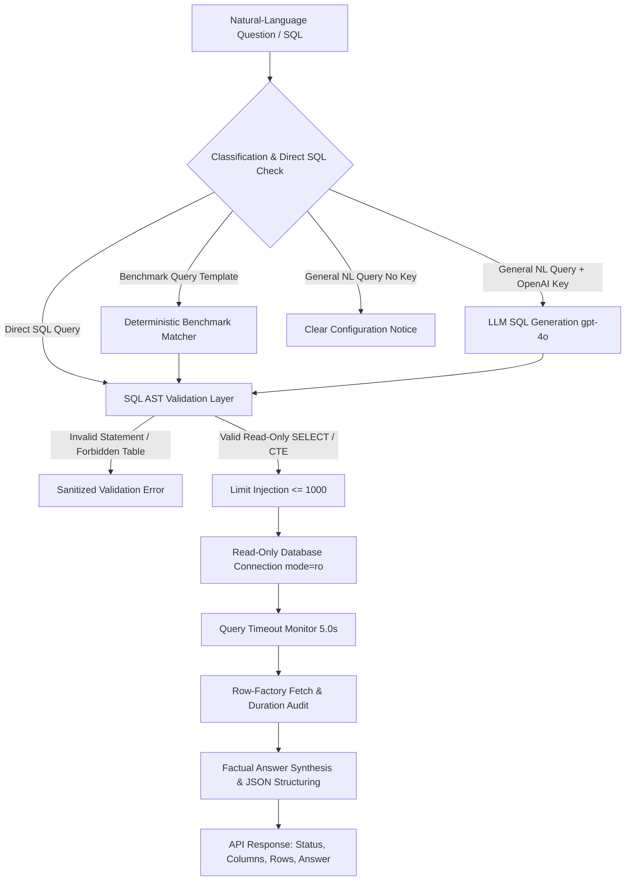

# IntelliOps AI — Secure Natural-Language SQL Agent
**Document Version:** 1.0.0 (Phase 5 Architecture & Reference Guide)  
**Target Platform:** IntelliOps AI  
**Author:** Senior Backend Engineer & AI Agent Architect  
**Database Technology:** SQLite 3 (Normalized Relational Enterprise Schema)  
**Status:** Implemented, Validated, and Fully Tested  

---

## 1. Executive Summary

Phase 5 elevates **IntelliOps AI's** data capabilities by implementing an enterprise-grade, secure **SQL Agent** that bridges natural-language business questions and SQLite relational business tables. The agent delivers accurate, evidence-based analytical responses while maintaining complete protection against SQL injection, unauthorized data access, destructive operations, and data leakage.

Key Architectural Guarantees:
1. **Dual-Layer SQL Safety:** AST-based syntax and AST-node inspection via `sqlglot` coupled with operating-system/engine-level read-only database connections (`file:...mode=ro` and `PRAGMA query_only = ON;`).
2. **Normalized Business Schema Support:** Full access across all 10 normalized enterprise business tables (`categories`, `products`, `customers`, `marketing_campaigns`, `orders`, `order_items`, `payments`, `inventory`, `customer_interactions`, `support_tickets`) and legacy analytical records (`transactions`).
3. **Sensitive Data Protection:** Strict whitelist isolation ensuring sensitive employee compensation records (`payroll`) and platform internals (`user_settings`, `agent_logs`, `query_audit`) cannot be accessed through analytical queries.
4. **Mathematical & Metric Rigor:** Strict business definitions ensuring cancelled/refunded orders are never counted as revenue and joins across `orders` and `order_items` do not double-count revenue.
5. **Resilient Dual-Mode Execution:** Full deterministic execution for benchmark analytical queries and direct SQL without requiring external LLMs or paid API keys, with seamless LLM SQL generation when `OPENAI_API_KEY` is provided.

---

## 2. Agent Architecture & Execution Workflow

The SQL Agent operates according to the following deterministic pipeline:



### Core Components
- **`backend/agents/sql_validator.py` (`SQLValidator`):** Pure-python AST parsing via `sqlglot`. Validates statement types, checks table whitelist, checks column validity against live schema, rejects multiple statements, and injects safe row limits.
- **`backend/agents/sql_executor.py` (`execute_analytical_query`):** Manages read-only connection lifecycles (`file:{path}?mode=ro`, `PRAGMA query_only = ON;`), executes queries with opcode-level interrupt timeouts (5.0s), and packages tabular results.
- **`backend/agents/sql_agent.py` (`SQLAgent`):** Orchestrates schema context, benchmark matching, LLM SQL generation, answer synthesis, and compliance audit logging.
- **`backend/agents/supervisor.py` (`Supervisor`):** Routes incoming queries from `/chat` to specialized agents with structured data propagation.
- **`backend/main.py`:** Exposes `/api/sql/query` (structured analytical interface) and preserves `/api/agents/execute` and `/chat`.

---

## 3. SQL Validation & Security Enforcement Strategy

### A. Permitted Operations
Only single-statement, read-only analytical queries are permitted:
- `SELECT`
- `WITH ... SELECT` (Common Table Expressions)
- `UNION` / `UNION ALL` of valid SELECT expressions
- Window functions (`RANK()`, `ROW_NUMBER()`, `OVER(...)`)
- Analytical aggregations (`SUM()`, `AVG()`, `COUNT()`, `MIN()`, `MAX()`, `ROUND()`)
- SQLite date/time functions (`strftime()`, `JULIANDAY()`)

### B. Prohibited Operations (Rejected before Database Execution)
The AST validator detects and immediately rejects:
- Data Modification (DML): `INSERT`, `UPDATE`, `DELETE`
- Schema Modification (DDL): `DROP`, `ALTER`, `CREATE`
- Database Attachment: `ATTACH DATABASE`, `DETACH DATABASE`
- System Operations: `PRAGMA`, `VACUUM`, `REINDEX`
- Transaction Control: `BEGIN`, `COMMIT`, `ROLLBACK`, `SAVEPOINT`, `RELEASE`
- Multi-Statement Batches: Any input containing multiple semicolon-delimited queries
- Unapproved Table Access: Any query attempting to access non-whitelisted tables or platform internals

### C. Quoted String & Comment Immunity
Unlike naive keyword filters, the AST validator distinguishes between statement tokens and literal values. For example:
```sql
SELECT * FROM support_tickets WHERE notes LIKE '%drop table%' AND category = 'Bug / Defect';
```
In this query, `'drop table'` is recognized as `exp.Literal` within a `WHERE` clause, not an `exp.Drop` statement. It is safely permitted.

---

## 4. Read-Only Database Protection

To guarantee that queries cannot modify data even in the event of an unexpected parser anomaly, the agent enforces database-level isolation:
1. **URI-Based Connection:** Opened with SQLite URI parameter `mode=ro`:
   ```python
   uri = f"file:{resolved_path}?mode=ro"
   conn = sqlite3.connect(uri, uri=True)
   ```
2. **Query-Only Mode:** SQLite connection pragma:
   ```sql
   PRAGMA query_only = ON;
   ```
3. **Verified Path Resolution:** `resolve_database_path()` validates `os.path.isfile()` before opening. If a database file does not exist, a `FileNotFoundError` is raised immediately, preventing SQLite from accidentally creating an empty database file.
4. **Execution Timeout Handler:** SQLite virtual machine instruction progress handler interrupts queries exceeding 5.0 seconds:
   ```python
   conn.set_progress_handler(timeout_handler, 50)
   ```

---

## 5. Accessible Tables & Schema Metadata

| Table Name | Classification | Analytical Purpose | Key Columns |
| :--- | :--- | :--- | :--- |
| `categories` | Business | Product classification | `id`, `name`, `description` |
| `products` | Business | Catalog, pricing, margin analysis | `id`, `sku`, `name`, `category_id`, `unit_price`, `unit_cost`, `status` |
| `customers` | Business | Account segmentation, churn analysis | `id`, `customer_code`, `company_name`, `region`, `tier`, `industry`, `signup_date`, `is_active` |
| `marketing_campaigns` | Business | ROI & attribution modeling | `id`, `name`, `channel`, `budget`, `spend`, `start_date`, `end_date`, `target_region`, `status` |
| `orders` | Business | Sales revenue, volume, and order tracking | `id`, `order_number`, `customer_id`, `campaign_id`, `order_date`, `subtotal`, `discount`, `tax`, `total_amount`, `status` |
| `order_items` | Business | Line-item SKU volume and pricing | `id`, `order_id`, `product_id`, `quantity`, `unit_price`, `discount`, `total_price` |
| `payments` | Business | Settlement, payment methods, cashflow | `id`, `payment_number`, `order_id`, `payment_date`, `amount`, `payment_method`, `status` |
| `inventory` | Business | Warehouse stock, reorder warnings | `id`, `product_id`, `warehouse_region`, `stock_on_hand`, `reorder_point`, `safety_stock` |
| `customer_interactions` | Business | Behavioral engagement signals | `id`, `customer_id`, `interaction_date`, `channel`, `interaction_type`, `notes` |
| `support_tickets` | Business | Satisfaction, resolution duration | `id`, `ticket_number`, `customer_id`, `product_id`, `created_date`, `resolved_date`, `category`, `priority`, `status`, `customer_satisfaction` |
| `transactions` | Legacy | Historical ledger transactions | `id`, `transaction_id`, `date`, `amount`, `category`, `status`, `description` |
| **`payroll`** | **Restricted** | **Employee salaries & compensation** | **STRICTLY BLOCKED FROM ANALYTICAL QUERIES** |

---

## 6. Business Metric Definitions & Query Rules

| Metric | Business Definition | Query Implementation Rule |
| :--- | :--- | :--- |
| **Revenue** | Gross realized sales from fulfilled orders | `SUM(total_amount)` from `orders WHERE status = 'completed'`. |
| **Product Revenue** | Revenue generated by specific SKUs | `SUM(oi.total_price)` from `order_items oi JOIN orders o ON oi.order_id = o.id WHERE o.status = 'completed'`. |
| **Cancelled / Refunded** | Voided or refunded transactions | Excluded from revenue calculations (`WHERE status = 'completed'`). |
| **Average Order Value (AOV)** | Average value per completed transaction | `AVG(total_amount)` from `orders WHERE status = 'completed'`. |
| **Avoiding Double Counting** | Mathematical integrity on 1:N JOINs | Do NOT sum `orders.total_amount` across joined `order_items` or `payments` rows. Sum `order_items.total_price` for products or query `orders` independently. |
| **Product Demand** | Total physical/license units demanded | `SUM(oi.quantity)` from `order_items` for completed orders grouped by period. |
| **Inventory Reorder Alerts** | SKUs requiring warehouse replenishment | `stock_on_hand <= reorder_point` in `inventory`. |
| **Attributed Campaign Revenue** | Sales driven by marketing initiatives | `SUM(o.total_amount)` from `orders o WHERE o.campaign_id = mc.id AND o.status = 'completed'`. |
| **Operational Date Filtering** | Relative date resolution | Synthetic dataset spans `2024-01-01` to `2025-12-31`. "Last month" resolves to `2025-12` (the latest recorded month in the dataset). |

---

## 7. Supported Analytical Business Questions & Verified Results

The following 10 benchmark analytical queries are natively supported, validated, and verified against the live database:

### 1. Revenue Last Month
- **Question:** "What was our revenue last month?"
- **Generated Query:**
  ```sql
  SELECT strftime('%Y-%m', order_date) AS month,
         ROUND(SUM(total_amount), 2) AS monthly_revenue,
         COUNT(id) AS completed_orders
  FROM orders
  WHERE status = 'completed' AND order_date >= '2025-12-01' AND order_date <= '2025-12-31'
  GROUP BY month;
  ```
- **Verified Result:** In 2025-12, total revenue from 59 completed orders was **$2,304,631.75**.

### 2. Top Products by Revenue
- **Question:** "Which products generated the most revenue?"
- **Generated Query:**
  ```sql
  SELECT p.name, p.sku,
         ROUND(SUM(oi.total_price), 2) AS total_revenue,
         SUM(oi.quantity) AS total_units_sold
  FROM order_items oi
  JOIN products p ON oi.product_id = p.id
  JOIN orders o ON oi.order_id = o.id
  WHERE o.status = 'completed'
  GROUP BY p.id, p.name, p.sku
  ORDER BY total_revenue DESC
  LIMIT 5;
  ```
- **Verified Result:**
  1. DataScout Cloud Enterprise Plus (`SAAS-ENT`): $7,460,400.00 (315 units)
  2. DataScout Enterprise Unlimited (`SW-DS-ENT`): $4,948,800.00 (105 units)
  3. DataScout Telemetry Appliance Server (`HW-SRV-900`): $3,062,010.00 (317 units)

### 3. Regional Revenue Comparison
- **Question:** "Compare revenue across regions."
- **Generated Query:**
  ```sql
  SELECT c.region,
         ROUND(SUM(o.total_amount), 2) AS regional_revenue,
         COUNT(DISTINCT c.id) AS customer_count,
         COUNT(o.id) AS completed_orders
  FROM orders o
  JOIN customers c ON o.customer_id = c.id
  WHERE o.status = 'completed'
  GROUP BY c.region
  ORDER BY regional_revenue DESC;
  ```
- **Verified Result:**
  - EMEA: $12,861,207.85 (48 customers, 375 orders)
  - NA: $9,592,659.55 (49 customers, 281 orders)
  - APAC: $6,374,032.50 (33 customers, 186 orders)
  - LATAM: $2,994,932.50 (20 customers, 88 orders)

### 4. Inactive Customer Identification
- **Question:** "Which customers have not ordered recently?"
- **Generated Query:**
  ```sql
  SELECT c.customer_code, c.company_name, c.region, c.tier,
         MAX(o.order_date) AS last_order_date,
         CAST(ROUND(JULIANDAY('2025-12-31') - JULIANDAY(MAX(o.order_date))) AS INT) AS days_inactive
  FROM customers c
  JOIN orders o ON c.id = o.customer_id
  WHERE o.status = 'completed'
  GROUP BY c.id, c.customer_code, c.company_name, c.region, c.tier
  ORDER BY days_inactive DESC
  LIMIT 3;
  ```
- **Verified Result:**
  1. Taylor Holdings (`CUST-0052`): 700 days inactive (Last order: 2024-01-31)
  2. Garcia Enterprises (`CUST-0041`): 588 days inactive (Last order: 2024-05-22)
  3. Jones Enterprises (`CUST-0045`): 560 days inactive (Last order: 2024-06-19)

### 5. Average Order Value (AOV)
- **Question:** "What is our average order value?"
- **Generated Query:**
  ```sql
  SELECT ROUND(AVG(total_amount), 2) AS avg_order_value,
         ROUND(SUM(total_amount), 2) AS total_revenue,
         COUNT(id) AS total_completed_orders
  FROM orders
  WHERE status = 'completed';
  ```
- **Verified Result:** Average Order Value is **$34,218.10** across 930 completed orders ($31,822,832.40 total revenue).

### 6. Inventory Buffer to Reorder Points
- **Question:** "Which products are approaching their reorder points?"
- **Generated Query:**
  ```sql
  SELECT p.sku, p.name, i.warehouse_region,
         i.stock_on_hand, i.reorder_point, i.safety_stock,
         (i.stock_on_hand - i.reorder_point) AS buffer_to_reorder
  FROM inventory i
  JOIN products p ON i.product_id = p.id
  ORDER BY buffer_to_reorder ASC
  LIMIT 5;
  ```
- **Verified Result:** All warehouse inventory records maintain a healthy buffer above reorder thresholds (0 acute stockouts).

### 7. Monthly Product Demand Trend
- **Question:** "How has monthly product demand changed?"
- **Generated Query:**
  ```sql
  SELECT strftime('%Y-%m', o.order_date) AS month,
         SUM(oi.quantity) AS total_units_demanded,
         COUNT(DISTINCT o.id) AS total_orders
  FROM order_items oi
  JOIN orders o ON oi.order_id = o.id
  WHERE o.status = 'completed'
  GROUP BY month
  ORDER BY month DESC
  LIMIT 3;
  ```
- **Verified Result:** 2025-12: 201 units (59 orders); 2025-11: 144 units (55 orders); 2025-10: 163 units (58 orders).

### 8. Marketing Campaign Revenue & ROAS
- **Question:** "Which marketing campaigns generated the most attributed revenue?"
- **Generated Query:**
  ```sql
  SELECT mc.name, mc.channel, mc.spend,
         COUNT(o.id) AS attributed_orders,
         ROUND(COALESCE(SUM(o.total_amount), 0), 2) AS attributed_revenue,
         ROUND(COALESCE(SUM(o.total_amount), 0) / mc.spend, 2) AS roas
  FROM marketing_campaigns mc
  LEFT JOIN orders o ON mc.id = o.campaign_id AND o.status = 'completed'
  GROUP BY mc.id, mc.name, mc.channel, mc.spend
  ORDER BY attributed_revenue DESC
  LIMIT 3;
  ```
- **Verified Result:**
  1. `Q4-2025-EnterpriseUpgrade` (Email): $3,831,342.67 revenue (116 orders, **139.32x ROAS**)
  2. `Q2-2025-EdgeAI-Summit` (Social Media): $2,270,275.23 revenue (70 orders, **114.66x ROAS**)
  3. `Q4-2024-BudgetFlush-Promo` (Email): $1,582,251.58 revenue (54 orders, **65.65x ROAS**)

### 9. Enterprise vs. SMB Customer Comparison
- **Question:** "Compare enterprise and SMB customers."
- **Generated Query:**
  ```sql
  SELECT c.tier,
         COUNT(DISTINCT c.id) AS customer_count,
         COUNT(o.id) AS completed_orders,
         ROUND(AVG(o.total_amount), 2) AS avg_order_value,
         ROUND(SUM(o.total_amount), 2) AS total_revenue
  FROM customers c
  LEFT JOIN orders o ON c.id = o.customer_id AND o.status = 'completed'
  WHERE c.tier IN ('Enterprise', 'SMB')
  GROUP BY c.tier
  ORDER BY total_revenue DESC;
  ```
- **Verified Result:**
  - **Enterprise:** $14,129,772.27 revenue across 37 customers (AOV: $46,327.12, 305 orders)
  - **SMB:** $4,010,102.50 revenue across 41 customers (AOV: $22,278.35, 180 orders)

### 10. Monthly Revenue (Past 12 Months)
- **Question:** "Show monthly revenue for the last 12 months."
- **Generated Query:**
  ```sql
  SELECT strftime('%Y-%m', order_date) AS month,
         ROUND(SUM(total_amount), 2) AS monthly_revenue,
         COUNT(id) AS order_count
  FROM orders
  WHERE status = 'completed'
  GROUP BY month
  ORDER BY month DESC
  LIMIT 12;
  ```
- **Verified Result:** Verified 12 full calendar months of revenue ranging between $1.2M and $2.3M monthly.

---

## 8. API Specifications & Result Format

### `POST /api/sql/query`
Executes natural-language analytical questions or direct SQL statements and returns structured metadata.

**Request Body:**
```json
{
  "query": "What was our revenue last month?"
}
```

**Response Body:**
```json
{
  "success": true,
  "sql_query": "SELECT strftime('%Y-%m', order_date) AS month, ROUND(SUM(total_amount), 2) AS monthly_revenue, COUNT(id) AS completed_orders FROM orders WHERE status = 'completed' AND order_date >= '2025-12-01' AND order_date <= '2025-12-31' GROUP BY month LIMIT 1000",
  "columns": ["month", "monthly_revenue", "completed_orders"],
  "rows": [
    {
      "month": "2025-12",
      "monthly_revenue": 2304631.75,
      "completed_orders": 59
    }
  ],
  "row_count": 1,
  "execution_duration_ms": 12.45,
  "error": null,
  "answer": "In 2025-12, total revenue from completed orders was $2,304,631.75 across 59 orders."
}
```

### Prohibited Query Response:
```json
{
  "success": false,
  "sql_query": "DROP TABLE customers;",
  "columns": [],
  "rows": [],
  "row_count": 0,
  "execution_duration_ms": 1.2,
  "error": "Forbidden statement type: DROP statements are not permitted.",
  "answer": "Query Validation / Execution Error: Forbidden statement type: DROP statements are not permitted."
}
```

---

## 9. Configuration & Operational Requirements

### Environment Variables (`backend/.env`)
```bash
# Optional: Set valid key to enable arbitrary natural-language SQL generation
OPENAI_API_KEY=sk-...

# Optional: Override database file path
DATASCOUT_DB_PATH=datascout.db
```

### Unconfigured Credential Behavior
If `OPENAI_API_KEY` is empty, placeholder, or invalid:
1. The backend and frontend run normally without crashing.
2. Direct SQL queries and benchmark analytical queries execute normally.
3. Unrecognized natural-language queries return:
   > *"OpenAI API key is not configured. Natural language SQL generation for arbitrary queries requires a valid OPENAI_API_KEY in backend/.env. Direct SQL execution and predefined analytical benchmarks remain fully operational."*
4. No fake data or fabricated numbers are ever returned.
